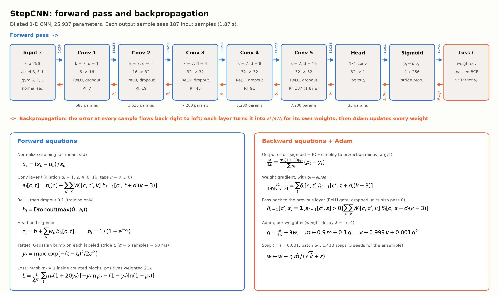

# Ankle IMU Step Counter

An ankle-worn step counter built on an **Arduino UNO Q** and an **MPU-6050** IMU. A small PyTorch neural network on the laptop counts steps and reports each count with a **calibrated confidence interval**, for example "40 steps, 90% interval 38–42".

**How it works:** the UNO Q's microcontroller reads the IMU at 100 Hz and sends batches over the Bridge to Python on the board's Linux side. Python relays them over MQTT to the laptop, which does everything else: recording, labeling, training, counting and the UI. The sensor sits on the right ankle only, so the network detects **right-foot strides** and reports **steps = 2 × strides**.

The model is a dilated 1-D CNN with 25,937 parameters. Each of its output samples sees 1.87 s of signal, and it outputs a stride probability for every sample. Five copies trained with different seeds form an ensemble, whose spread feeds the confidence interval.



## Results on the locked test sessions

S009 and S010 were never used for training or tuning, and were scored once at the end ([`reports/m10_final_test.md`](reports/m10_final_test.md)).

| Session | True steps | Neural network ensemble | Classical baseline (B2) |
|---|---|---|---|
| S009 (scripted movement) | 268 | 268 | 272 |
| S010 (everyday movement) | 90 | 88 | 60 |
| Turning in place | 20 | 20 | 8 |

All 16 of the 90% intervals contained the true count. One pre-registered criterion failed: with only 4 hard blocks in the test set, the network's lead over the baseline on hard movement was not statistically significant. The report explains this.

## Folder layout

```
board/                 UNO Q app for Arduino App Lab
  sketch/sketch.ino    MCU: MPU-6050 @ 100 Hz, batches of 10, LED status glyphs
  python/main.py       Linux side: relay to MQTT + local backup log
stepnet/               the laptop package
  io/                  MQTT link, stream decoding, session files, live input
  preprocess.py        units, body frame, calibration, gyro bias
  protocols.py         the guided recording protocols (A, B, C, test)
  labels.py            stride candidates and versioned label files
  baselines.py         classical peak detectors B1 and B2
  models/cnn.py        StepCNN
  train.py, infer.py   training, whole-session prediction, live engine
  uncertainty/         ensemble + conformal confidence intervals
  eval/                metrics and paired bootstrap
server/, web/          laptop UI (FastAPI + plain JS): Label and Live views
scripts/               every command-line step (below)
configs/cnn.yaml       model and training hyperparameters
models/                the trained 5-member ensemble + its calibration
data/                  raw sessions, labels, calibration, dataset manifests
reports/               results of each milestone
deliverables/          animation prompt, written explanation, network diagram
tests/                 unit tests
PLAN.md                every design decision and the full change log
```

## 1. Hardware

Use the same wiring as [`gait_identification`](../../gait_identification/README.md):

| MPU-6050 | UNO Q |
|---|---|
| VCC | 3.3V (not 5V) |
| GND | GND |
| SDA | SDA (next to AREF) |
| SCL | SCL (next to AREF) |

Strap the board rigidly to the **outside of the right ankle**, with the battery on the thigh. The code assumes S (up the shin) = −x, F (forward) = −y and L (toward your left) = +z. Every recording starts with a 5 s standing check that warns you if the mount has rotated.

## 2. Setup

**Laptop**, from the repo root:
```
python3 -m venv .venv
cd neuralnetstuff/step_counter
../../.venv/bin/pip install -r requirements.txt
../../.venv/bin/python -m pytest          # unit tests
brew install android-platform-tools       # adb, for copying files to and from the board
```

All commands below are run from `neuralnetstuff/step_counter/`.

**Board**, in Arduino App Lab:
1. Create an app called `stepcounter`.
2. Copy in the files:
   ```
   APP=/home/arduino/ArduinoApps/stepcounter
   adb push board/sketch/sketch.ino $APP/sketch/
   adb push board/python/main.py board/python/requirements.txt $APP/python/
   ```
3. Press **Run**. The LED matrix shows `-` while waiting, `C` once it's connected and streaming, `R` while recording, and `!` if the IMU isn't found.

**Check the stream:**
```
../../.venv/bin/python scripts/listen.py             # sample rate, gaps, latency, live accel/gyro
../../.venv/bin/python scripts/listen.py --test 300  # 5-minute PASS/FAIL stability test
```

Data travels over the public broker `broker.emqx.io` on topics `ME193/Julian/StepCounter/{imu,status,cmd}`. To use your own topics, set `STEPNET_BASE_TOPIC`.

No board yet? `scripts/fake_board.py` publishes a synthetic stream on the same topics (`--walk-cycle` alternates standing and leg swings).

**If the board connects but no IMU data arrives:** after App Lab re-flashes the board, the MCU can hang on I2C. Unplug the MPU's VCC for 2 s, or power-cycle the board, then press Run again.

## 3. Record sessions

One-time six-pose accelerometer calibration:
```
../../.venv/bin/python scripts/calibrate_accel.py
```

Then record guided sessions. Spoken cues lead you through each block, so you never touch the laptop mid-session. Afterwards you confirm how many steps you took in each bout.
```
../../.venv/bin/python scripts/record.py --protocol test          # short dry run -> T###
../../.venv/bin/python scripts/record.py --protocol A --stairs    # movement: walking, stairs, turns, side/back steps
../../.venv/bin/python scripts/record.py --protocol B             # hard non-steps: leg swings, shuffles, taps
../../.venv/bin/python scripts/record.py --protocol C             # everyday movement with counted blocks
```

Sessions are saved to `data/raw/S###/` as `imu.csv` plus `meta.json`. If MQTT dropped samples, `record.py` prints the `adb pull` and `scripts/fill_gaps.py` commands that restore them from the board's backup log. To check a recording, run `scripts/plot_session.py S001`.

## 4. Label strides

```
../../.venv/bin/python scripts/serve.py      # opens http://127.0.0.1:8000
```

In the **Label** tab, pick a session. Candidate strides are proposed automatically: forward steps at the L-gyro minimum, turns and side steps at the peak rotation rate. Accept, reject or move each candidate until each block's stride count matches the step count you entered (within ±1). Labels are saved as versioned files under `data/labels/`. To open a session directly, use `#S005`.

## 5. Train and evaluate

The model settings are in `configs/cnn.yaml`. Any of them can be overridden on the command line, for example `train.epochs=40`.
```
../../.venv/bin/python scripts/evaluate_baselines.py           # tune + score B1/B2 -> reports/m4_baselines.md
../../.venv/bin/python scripts/train.py --loso                 # CNN vs B2, leave-one-session-out -> reports/m5_cnn_loso.md
../../.venv/bin/python -u scripts/uncertainty.py --cv          # calibrate the intervals -> reports/m6_uncertainty.md
../../.venv/bin/python -u scripts/uncertainty.py --train-final # final 5-model ensemble -> models/cnn_ensemble_v1/
../../.venv/bin/python scripts/final_test.py --final           # one-time test on S009/S010 -> reports/m10_final_test.md
```

**S009 and S010 are the locked test set.** Every training and tuning script excludes them. `final_test.py` is the only script that reads them, and it was meant to run once. Training one model takes about 17 s on an Apple-silicon GPU (MPS); `device: auto` picks MPS, CUDA or the CPU.

## 6. Count steps live

Start the UI with `scripts/serve.py` and open the **Live** tab. It runs the ensemble on the stream from the board and shows:
- the IMU signals with detected strides marked;
- the network's stride probability and its layer activations;
- a running step count with its confidence interval.

To replay a recorded session through the same pipeline without the board, use `#live=S005` (or any session id).

## 7. Deliverables

- [`deliverables/written_explanation.md`](deliverables/written_explanation.md): how the project works, in short.
- [`deliverables/network_diagram.png`](deliverables/network_diagram.png): the block diagram above, made by `scripts/plot_network.py`.
- [`deliverables/animation_prompt.md`](deliverables/animation_prompt.md): a prompt for another Claude chat to build an animated explainer of the model.
