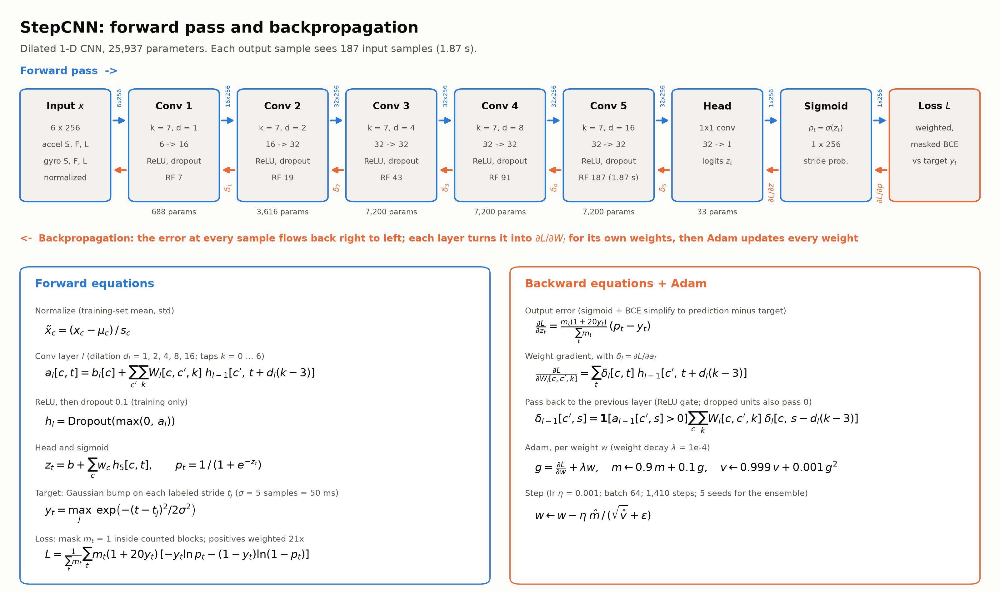

# Step counter: written explanation (draft 2)

I built a step counter from an MPU-6050 IMU strapped to the outside of my right ankle, read by an Arduino UNO Q that streams six channels (3-axis acceleration and 3-axis rotation rate) at 100 Hz over MQTT to my laptop. Over ten guided recording sessions I collected three kinds of data: normal movement (walking at different speeds, stairs, turns, side and back steps), deliberately hard "non-steps" that look like steps to a sensor (seated leg swings, shuffles, toe taps), and everyday mixed movement. I labeled every right-foot stride by hand in a custom labeling tool. Because the sensor only sits on one ankle, the counter detects right-foot strides and reports total steps as two times the stride count. I held out the last two sessions as a locked test set that was never used for training or tuning.

The model is a small one-dimensional convolutional neural network written in PyTorch, with 25,937 parameters. It reads 2.56 second windows of normalized IMU data (model input) and outputs, for every sample, the *probability* that a stride is happening at that moment (model output). The last layer produces a raw score for each sample, and a sigmoid function squashes that score into a value between 0 and 1, where values near 0 mean "no stride here" and values near 1 mean "a stride is happening right now." Its five convolution layers use increasing dilation (1, 2, 4, 8, 16), so that each output can see 1.87 s of signal, enough to cover a whole stride, without needing many layers or weights:

The model was trained to reproduce a target signal built from my labels: a small Gaussian bump (standard deviation 50 ms) centred on each labeled stride and zero elsewhere, so a prediction a few samples early or late still counts as mostly correct. Training used a weighted binary cross-entropy loss that makes missed strides expensive and ignores unlabeled stretches of data, along with backpropagation, the Adam optimizer, and small random rotations and scalings of the data to imitate the strap sitting slightly differently. After each batch, backpropagation starts from the error at every sample (the predicted probability minus the Gaussian target) and passes it backward through the layers with the chain rule, which tells each of the 25,937 weights whether, and by how much, it should change to reduce the loss; Adam then applies those updates, so over 1,410 batches the network gradually learns which signal patterns mean a stride. To count steps, the network slides along a recording and the overlapping window outputs are blended, so each stride appears as a smooth hill in the probability trace. Each hill whose peak rises above 0.5 is counted as one stride. To attach a confidence interval to each count, I trained five copies of the network with different random seeds. The interval combines how unsure each network is about each peak, how much the five copies disagree, and the ±1 uncertainty that comes from doubling strides, and it was calibrated on held-out data so that a "90%" interval really contains the true count about 90% of the time.

On the locked test sessions the network counted 268 steps where the true count was 268, and 88 where it was 90, compared with 272 and 60 for a classical baseline (peak detection on the rotation signal plus a heel-strike impact check). The difference was largest on unusual movement: turning in place, the network counted 20 of 20 steps while the baseline found only 8. All 16 test intervals contained the true count. One pre-registered test was not met: with only four hard blocks in the test set, the network's advantage over the baseline on hard movements could not be shown to be statistically significant, even though it was ahead. The main lesson for me was that the network's advantage came less from its size than from the data and the labeling: deliberately recording the movements that fool a simple detector is what taught the model to tell them apart.
