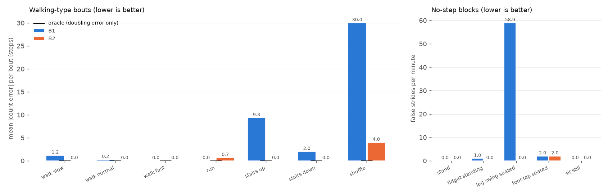
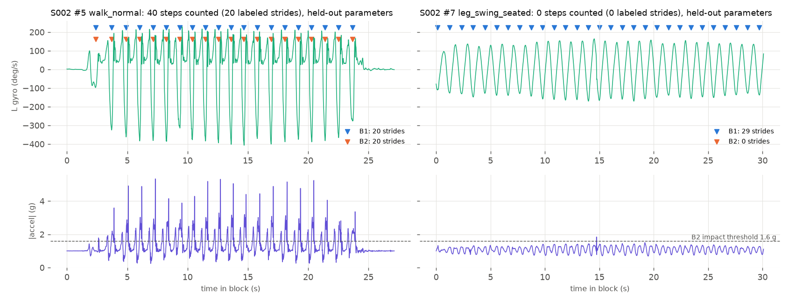

# M4: Classical baselines (leave-one-session-out)

Generated 2026-11-02 16:36 by `scripts/evaluate_baselines.py`. 5 sessions (S001, S002, S003, S004, S005), 43 usable blocks, 442 labeled strides. Each session's numbers come from parameters tuned on the other four. Values: point estimate [95% bootstrap CI over blocks].

| metric | B1 peak detection | B2 + heel-strike gate | oracle (labels) |
|---|---|---|---|
| stride F1 | 0.882 [0.774, 0.960] | 0.989 [0.972, 0.999] | 1.000 [1.000, 1.000] |
| recall | 0.907 [0.821, 0.968] | 0.989 [0.970, 1.000] | 1.000 [1.000, 1.000] |
| precision | 0.859 [0.683, 0.988] | 0.989 [0.972, 1.000] | 1.000 [1.000, 1.000] |
| mean abs count error per bout (steps) | 2.77 [0.83, 5.68] | 0.23 [0.00, 0.62] | 0.00 [0.00, 0.00] |
| net count error, all bouts (%) | -8.1 [-17.2, -2.3] | -0.2 [-1.4, +0.6] | +0.0 [+0.0, +0.0] |
| false strides / min in no-step blocks | 13.1 [0.3, 28.1] | 0.2 [0.0, 0.6] | 0.0 [0.0, 0.0] |

## Per activity (held-out)

| activity | kind | blocks | B1 abs err / bout | B2 abs err / bout | B1 false/min | B2 false/min | B1 recall | B2 recall |
|---|---|---|---|---|---|---|---|---|
| stand | no-step | 10 | 0.00 | 0.00 | 0.0 | 0.0 | 0.00 | 0.00 |
| walk_slow | bout | 5 | 1.20 | 0.00 | 0.0 | 0.0 | 0.96 | 1.00 |
| walk_normal | bout | 8 | 0.25 | 0.00 | 0.3 | 0.0 | 0.99 | 1.00 |
| walk_fast | bout | 3 | 0.00 | 0.00 | 0.9 | 0.0 | 0.98 | 1.00 |
| run | bout | 3 | 0.00 | 0.67 | 0.0 | 1.1 | 1.00 | 1.00 |
| stairs_up | bout | 3 | 9.33 | 0.00 | 1.3 | 3.8 | 0.58 | 0.92 |
| stairs_down | bout | 3 | 2.00 | 0.00 | 2.7 | 0.0 | 0.86 | 1.00 |
| fidget_standing | no-step | 2 | 1.00 | 0.00 | 1.0 | 0.0 | 0.00 | 0.00 |
| leg_swing_seated | no-step | 2 | 59.00 | 0.00 | 58.9 | 0.0 | 0.00 | 0.00 |
| foot_tap_seated | no-step | 1 | 2.00 | 2.00 | 2.0 | 2.0 | 0.00 | 0.00 |
| sit_still | no-step | 2 | 0.00 | 0.00 | 0.0 | 0.0 | 0.00 | 0.00 |
| shuffle | bout | 1 | 30.00 | 4.00 | 0.0 | 0.0 | 0.00 | 0.87 |

## Per session: net count error over all bouts (held-out)

| session | counted steps | B1 | B2 | oracle |
|---|---|---|---|---|
| S001 | 238 | -16 (-6.7%) | +0 (+0.0%) | +0 (+0.0%) |
| S002 | 70 | +60 (+85.7%) | +2 (+2.9%) | +0 (+0.0%) |
| S003 | 238 | -14 (-5.9%) | +0 (+0.0%) | +0 (+0.0%) |
| S004 | 70 | +62 (+88.6%) | +0 (+0.0%) | +0 (+0.0%) |
| S005 | 268 | -42 (-15.7%) | -2 (-0.7%) | +0 (+0.0%) |

## Parameters

Tuned on all five sessions (for later live use):

- B1: `{"cutoff_hz": 8.0, "height_dps": 180, "prominence_dps": 20, "min_gap_s": 0.3}`
- B2: `{"cutoff_hz": 3.0, "height_dps": 40, "prominence_dps": 20, "min_gap_s": 0.5, "impact_g": 1.6, "impact_window_s": 0.4}`

Per fold (tuned without that session):

- S001: B1 `{"cutoff_hz": 8.0, "height_dps": 180, "prominence_dps": 20, "min_gap_s": 0.3}`, B2 `{"cutoff_hz": 3.0, "height_dps": 40, "prominence_dps": 20, "min_gap_s": 0.5, "impact_g": 1.6, "impact_window_s": 0.4}`
- S002: B1 `{"cutoff_hz": 5.0, "height_dps": 40, "prominence_dps": 120, "min_gap_s": 0.5}`, B2 `{"cutoff_hz": 5.0, "height_dps": 40, "prominence_dps": 120, "min_gap_s": 0.5, "impact_g": 1.6, "impact_window_s": 0.4}`
- S003: B1 `{"cutoff_hz": 8.0, "height_dps": 180, "prominence_dps": 20, "min_gap_s": 0.3}`, B2 `{"cutoff_hz": 3.0, "height_dps": 40, "prominence_dps": 20, "min_gap_s": 0.5, "impact_g": 1.6, "impact_window_s": 0.4}`
- S004: B1 `{"cutoff_hz": 3.0, "height_dps": 40, "prominence_dps": 20, "min_gap_s": 0.5}`, B2 `{"cutoff_hz": 3.0, "height_dps": 40, "prominence_dps": 20, "min_gap_s": 0.5, "impact_g": 1.6, "impact_window_s": 0.4}`
- S005: B1 `{"cutoff_hz": 8.0, "height_dps": 180, "prominence_dps": 20, "min_gap_s": 0.3}`, B2 `{"cutoff_hz": 3.0, "height_dps": 40, "prominence_dps": 20, "min_gap_s": 0.5, "impact_g": 1.6, "impact_window_s": 0.4}`

