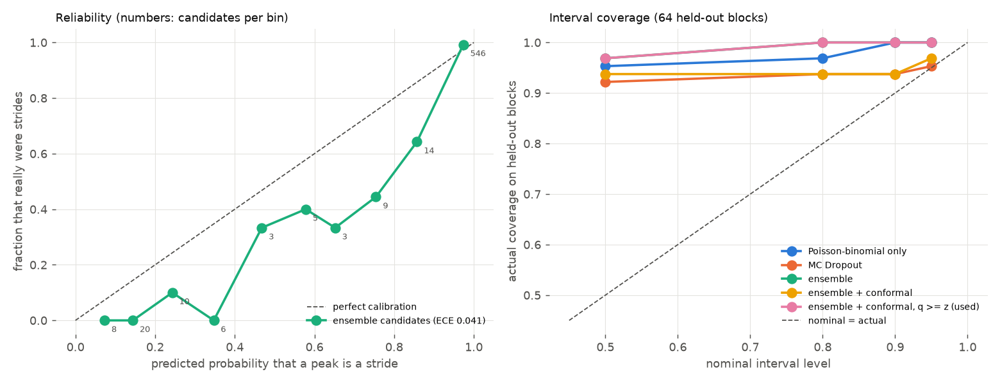

# M6: Uncertainty and calibration (4-fold cross-validation, training sessions only)

Generated 2026-11-02 18:31 by `scripts/uncertainty.py --cv`. 5 CNNs per fold (seeds 0-4), 64 held-out blocks. Folds: S001+S006, S002+S008, S003+S004, S005+S007.

## Coverage: how often the counted steps fall inside the interval (and mean width in steps)

| method | 50% | 80% | 90% | 95% |
|---|---|---|---|---|
| Poisson-binomial only | 95% (±0.8) | 97% (±1.5) | 100% (±1.9) | 100% (±2.2) |
| MC Dropout | 92% (±0.4) | 94% (±0.8) | 94% (±1.0) | 95% (±1.1) |
| ensemble (Gaussian z) | 97% (±0.8) | 100% (±1.6) | 100% (±2.1) | 100% (±2.5) |
| ensemble + conformal | 94% (±0.0) | 94% (±0.0) | 94% (±0.1) | 97% (±0.9) |
| **ensemble + conformal, q ≥ z** (used) | 97% (±0.8) | 100% (±1.6) | 100% (±2.1) | 100% (±2.5) |

## Coverage at 90%, by kind of block

| interval | scripted | hard subset |
|---|---|---|
| ensemble (Gaussian z) | 100% of 54 | 100% of 10 |
| ensemble + conformal | 100% of 54 | 60% of 10 |
| **ensemble + conformal, q ≥ z** (used) | 100% of 54 | 100% of 10 |

## Ensemble vs one CNN (same folds)

- mean |count error| per block with steps: ensemble 0.26, single CNN 0.31
- false strides in no-step blocks: ensemble 0, single CNN 0

## Reliability of candidate probabilities: ECE 0.041 over 624 candidates

## Interval factors used by the final ensemble (all CV blocks)

q50: conformal 0.00 -> used 0.67, q80: conformal 0.00 -> used 1.28, q90: conformal 0.00 -> used 1.64, q95: conformal 0.55 -> used 1.96 (used = max(conformal, Gaussian z))
